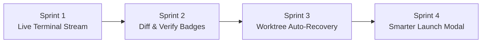

# Implementation Plan: Agents Tab Upgrade (4 Sprints)

This document outlines the detailed architectural and engineering plan for upgrading the **Agents (`F4`)** pane and the **Agent Launch Modal (`a` / `Ctrl+A`)** across four focused sprints.



---

## Sprint 1: Live Terminal Activity Preview (#1)

### Goal
Show what each agent is currently doing or asking directly on its card in the Agents pane without switching terminal tabs.

### Architecture & Logic
1. **`src/terminal.rs`**:
   * Add `pub fn last_non_empty_line(&self) -> Option<String>` to `TerminalSession`.
   * Access the `vt100::Parser` grid screen, scan rows from bottom to top, trim whitespace/control escape sequences, and extract the most recent active output line.
   * Strip ANSI escape artifacts and truncate long lines cleanly (e.g., max 80 chars) to prevent UI overflow.
2. **`src/agents.rs`**:
   * Extend `AgentSession` struct with:
     * `pub last_output_line: Option<String>`
     * `pub diff_summary: Option<String>`
     * `pub last_verify_passed: Option<bool>`
     * `pub last_stat_check: Option<Instant>`
3. **`src/app.rs`**:
   * In `App::update_agent_heuristics()`, query `term.last_non_empty_line()` and store it in `agent.last_output_line`.
4. **`src/ui.rs`**:
   * In `draw_agents_pane()`, display a quote line under each active card:
     ```text
     ↳ 💬 "Apply changes to src/auth.rs? [y/n]"
     ```
   * Style in warning color when `WaitingForInput`, and muted/secondary when `Running`.

---

## Sprint 2: Live Git Diff Summary & Verification Badges (#3)

### Goal
Display real-time worktree modification metrics (`N files (+X -Y)` or `Clean`) and pre-merge verification status (`✔ Verified` / `✖ Failed`) on each card.

### Architecture & Logic
1. **`src/worktree.rs`**:
   * Add `pub fn get_diff_shortstat(&self) -> Option<String>`:
     * Executes `git status --porcelain` in `self.path` to count modified/untracked files.
     * Executes `git diff HEAD --shortstat` to get added/deleted line counts.
     * Formats into a concise badge: `"3 files (+48 -12)"`, `"1 file"`, or `"Clean"`.
2. **`src/app.rs`**:
   * In `App::update_agent_heuristics()`, throttle diff checks so they run at most once every ~4 seconds per active worktree. This prevents shelling out to `git` on every frame, preserving the 60 FPS UI loop.
   * In `App::verify_active_agent()`, update `agent.last_verify_passed = Some(passed)` to remember the verification outcome.
3. **`src/ui.rs`**:
   * Render the diff badge and verification status into the card metadata:
     * Card Title Line: `▶ ● Antigravity Running [Confirmed] 4m [✔ PASS]`
     * Worktree Branch Line: `↳ Branch: tide/agy-1 │ Tab #2 │ Δ 3 files (+48 -12)`

---

## Sprint 3: Auto-Discover Existing `.tide/worktrees/` on Startup (#2)

### Goal
Recover and display existing worktrees in `.tide/worktrees/` when TIDE launches or switches workspaces. Allow re-attaching an interactive shell with `Enter` so orphaned sessions are never stranded on disk.

### Architecture & Logic
1. **`src/worktree.rs`**:
   * Add `pub fn discover_existing(repo_root: &Path, default_base: &str) -> Vec<(WorktreeInfo, String, String)>`:
     * Scans `<repo_root>/.tide/worktrees/*` for valid directories.
     * Parses `.tide/TASK.md` inside each worktree (created during initial launch) to extract:
       * **Agent Name**
       * **Branch**
       * **Base Branch**
       * **Task Description**
     * If `TASK.md` is missing, infers the branch name (`tide/<folder>`) and session name from the folder name.
2. **`src/app.rs`**:
   * Add `pub fn load_existing_worktrees(&mut self)` and invoke it in `App::new()` and `App::switch_workspace()`.
   * Inserts discovered sessions into `self.agents` with:
     * `state: AgentState::Idle`
     * `terminal_idx: None` (detached)
     * Initial diff summary pre-computed.
   * Upgrade `KeyCode::Enter` on `ActivePane::Agents`:
     * If `agent.terminal_idx` exists, switch to that terminal tab.
     * If `agent.terminal_idx` is `None` (a recovered session), spawn an interactive shell in `wt.path`, set `agent.terminal_idx = Some(new_idx)`, mark `agent.state = AgentState::Running`, and switch focus to the Terminal pane.
3. **`src/ui.rs`**:
   * Display `Detached [Enter: Attach Shell]` for recovered sessions.
   * Update the pane title to reflect active vs. recovered counts: `Agents (1 running, 3 recovered)`.

---

## Sprint 4: Smarter Agent Launch Modal (`[a]`) (#5)

### Goal
Expand built-in presets, support custom agents from `.tide.toml`, and check whether CLIs are installed on the user's system with live `[✓ Installed]` / `[⚠ Not in PATH]` badges.

### Architecture & Logic
1. **`src/terminal.rs`**:
   * Add `pub fn is_command_available(command: &str) -> bool`:
     * Checks if `command` resolves to an existing file in `PATH` or standard user profile directories (`~/.local/bin`, `%LOCALAPPDATA%`, `%APPDATA%\npm`, etc.).
2. **`src/agents.rs` & `src/app.rs`**:
   * Define `AgentPreset` model with:
     * `name: String`
     * `command: String`
     * `args: Vec<String>`
     * `description: String`
     * `tag: String`
     * `tag_color: Color`
     * `is_installed: bool`
   * Provide first-class built-in presets:
     1. **Antigravity CLI** (`agy`)
     2. **Claude Code CLI** (`claude`)
     3. **Gemini CLI** (`gemini`)
     4. **Codex CLI** (`codex`)
     5. **Aider** (`aider`)
     6. **Isolated Worktree Shell** (`powershell.exe` / `bash`)
   * Dynamically append custom `[[agents]]` defined in `.tide.toml`.
   * Pre-scan `is_installed` status when the modal is opened.
3. **`src/ui.rs`**:
   * Update `draw_agent_launch_modal()` to render the dynamic list with scroll support if items exceed vertical space.
   * Render installation status badges:
     * `[✓ Installed]` in green
     * `[⚠ Not Found]` in muted/warning
   * Update modal keyboard/mouse handlers to support dynamic item count navigation and direct number selection `1..9`.

---

## Summary of Files to Modify

| File | Responsibilities |
| :--- | :--- |
| [`src/terminal.rs`](src/terminal.rs) | Extract last non-empty line from VT100 screen buffer; check CLI binary availability |
| [`src/worktree.rs`](src/worktree.rs) | Worktree directory discovery, `TASK.md` parsing, and diff shortstat computation |
| [`src/agents.rs`](src/agents.rs) | Extend `AgentSession` fields (output preview, diff stats, verify status) |
| [`src/app.rs`](src/app.rs) | Worktree auto-load on startup, attach shell on Enter, dynamic presets, throttled stat polling |
| [`src/ui.rs`](src/ui.rs) | 4-line agent cards, live status badges, dynamic launch modal with install tags |

