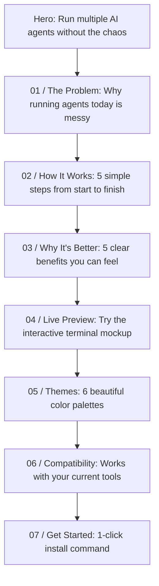

# TIDE Website Content Proposal (Plain-English Edition)
> **Goal**: Explain what TIDE does in simple, clear language that *any developer or tech enthusiast* will immediately understand in 5 seconds.  
> **Layout Style**: Clean, numbered, narrative structure inspired by [DevThread](https://devthread.pages.dev/).

---

## The Big Idea in 10 Seconds

> **The Problem**: When you run AI coding agents (like Claude Code, Antigravity, or Aider) on your computer, they often overwrite each other's files, leave behind invisible background servers that eat your RAM and lock ports, and make your terminal lag.
>
> **The Solution**: **TIDE** is a fast, lightweight terminal made specifically for AI coding agents. It gives every agent its own private copy of your project to work in, stops them from fighting over files, and guarantees that when you close an agent, all its hidden background tasks are completely shut down.

---

## Complete Section-by-Section Outline



---

### Top Navigation Bar
* **Logo**: Clean wave logo + `TIDE`
* **Links**:
  - `How it works`
  - `The Problem`
  - `Benefits`
  - `Live Preview`
  - `Themes`
  - `Specs`
  - `Docs` *(Links to `/docs`)*
* **Right Side**:
  - Keyboard shortcuts button `?`
  - `GitHub ↗`
  - **`Install TIDE ↗`** *(Solid button)*

---

### Hero Section: The First Impression

* **Eyebrow**: `— A TERMINAL WORKSPACE FOR AI CODING AGENTS`
* **Main Headline**:
  > # Run multiple AI agents.
  > # Without the chaos.
* **Sub-headline**: 
  > Give each coding agent its own private workspace. No file collisions, no broken branches, and no runaway background servers.
* **Short Description**:
  > Running multiple agents in the same folder leads to messy Git conflicts and frozen terminals. TIDE lets you run agents side-by-side in isolated sandboxes so they can code, test, and build without breaking your project.
* **Buttons**:
  - Primary button: `Install TIDE ↗`
  - Secondary text link: `See how it works →`
* **Quick Install Box**:
  ```bash
  cargo install --git https://github.com/sadia/TIDE
  ```
  *(With 1-click Copy button)*
* **Footnote**: `Lightweight single binary · Starts in <0.5s · Uses ~14 MB RAM · Zero Electron bloat`
* **Right-Side Visual (Simple 3-Step Live Status Board)**:
  - Header: `● Active Project · 3 agents running`
  - **Step 1: Your Project** (`my-project/`) `[Safe on main branch]`
  - *Arrow*: `Agent gets a private copy to work in`
  - **Step 2: Private Sandbox** (`agent-claude/`) `[Isolated]`
    - Working on: Refactoring database layer
    - Cleanup guard: Active *(closes background servers automatically)*
  - *Arrow*: `Ready for your review`
  - **Step 3: Review Changes** `[Ready]`
    - See what the agent changed before merging it into your real code.

---

### 01 / THE PROBLEM: What Happens Today

* **Section Tag**: `01 / THE PROBLEM`
* **Headline**:
  > ## Running AI agents in the same folder is messy.
* **Subtext**:
  > Autonomous coding agents are great, but when they run uncontrolled on your machine, three frustrating things happen:
* **The 3 Everyday Headaches**:
  1. `01` **Agents overwrite each other's work**  
     If two agents edit files at the same time, one accidentally erases what the other just built. You end up with broken code and confusing Git merge conflicts.
  2. `02` **Ghost servers keep running in the background**  
     Agents frequently start background test runners, compiler watchers, and web servers. When you close your terminal, Windows doesn't always kill them—leaving phantom processes that drain your battery and block ports like `localhost:3000`.
  3. `03` **Endless build logs freeze your terminal**  
     When an agent runs a big test suite or build command, thousands of lines of output flood the screen, causing normal terminal windows to stutter, drop frames, and ignore your typing.

---

### 02 / THE WORKFLOW: How TIDE Fixes It

* **Section Tag**: `02 / THE WORKFLOW`
* **Headline**:
  > ## You set the task.
  > ## TIDE keeps your project safe.
* **Top Right Link**: `Read the step-by-step guide ↗`
* **5 Clear Steps**:
  1. `01 Launch in seconds`  
     Type `tide .` in any folder. Press `Ctrl+N` to start an agent session.
  2. `02 Instant Private Copy`  
     TIDE gives each agent its own isolated workspace (using Git worktrees). The agent can edit, create, and delete files without touching your main branch.
  3. `03 Automatic Cleanup Guard`  
     Every agent runs inside a strict operating-system sandbox. When you close the session, every single child process, test server, and watcher is instantly terminated. Zero leftovers.
  4. `04 Compare Changes Side-by-Side`  
     Press `Ctrl+G` to view a clean diff of everything the agent modified. You stay in control of what enters your codebase.
  5. `05 Merge Cleanly`  
     Once you verify the code works, approve it with one keystroke. TIDE merges the changes back into your main branch and cleans up the temporary folder automatically.

---

### 03 / WHY DEVELOPERS USE IT: Clear Benefits

* **Section Tag**: `03 / WHY DEVELOPERS USE IT`
* **Headline**:
  > ## Built for speed.
  > ## Kept lightweight.
* **Subtext**: Everything you need to manage agents comfortably, without the bloat.
* **Asymmetric Bento Grid**:
  - **Big Featured Card (Left)**:
    - ⚡ **Zero Ghost Processes**
    - "When you quit an agent, it actually quits."
    - TIDE binds child processes directly to the Windows kernel. You'll never have to open Task Manager again just to kill lingering background servers holding onto port 3000 or 8080.
  - **Card 1**: **Private Workspaces**  
    Each agent works on its own copy. You can keep writing code in VS Code while 2 or 3 agents build features in the background.
  - **Card 2**: **Smooth 60 FPS Terminal**  
    TIDE smoothly paces output so even massive 10,000-line build dumps won't lag your screen or delay your keystrokes.
  - **Card 3**: **Uses Only ~14 MB of RAM**  
    Built from scratch in pure Rust, not Electron. It starts instantly (<480ms) and won't hog your laptop's memory.
  - **Card 4**: **Simple Setup**  
    One simple settings file (`tide.toml`) to customize your favorite AI agents, shortcuts, and themes.

---

### 04 / LIVE PREVIEW: A Familiar Terminal

* **Section Tag**: `04 / LIVE PREVIEW`
* **Headline**:
  > ## Switch between agents like browser tabs.
* **Layout**:
  - **Left Side (Quick Cheatsheet)**:
    - `Ctrl+N` — New Agent Tab
    - `Ctrl+Tab` — Switch to next agent
    - `Ctrl+G` — Review changes side-by-side
    - `Ctrl+P` — Quick command menu
    - Live Status: Shows agents currently active in their private workspaces.
  - **Right Side (Interactive Terminal Mockup)**:
    - The actual interactive Ratatui simulation where visitors can click tabs (`agy`, `claude`, `powershell`), see terminal output, and test the diff review modal.

---

### 05 / THEMES: Easy on the Eyes

* **Section Tag**: `05 / THEMES`
* **Headline**:
  > ## Six beautiful built-in themes.
* **Description**:
  > Designed for long coding sessions. Click any card below or press keys `1` through `6` on your keyboard to switch the theme across this entire website in real time.
* **Themes**: `TIDE Ocean`, `Tokyo Night`, `Catppuccin Mocha`, `Nord`, `Gruvbox Dark`, `Cyberpunk Neon`.

---

### 06 / COMPATIBILITY: Works With Your Tools

* **Section Tag**: `06 / COMPATIBILITY`
* **Headline**:
  > ## Plugs into your existing setup.
* **Evidence Rows**:
  1. **Any AI Agent CLI** — Works with Claude Code, Antigravity, Aider, Codex, or your own custom scripts. `[ Any CLI ]`
  2. **Standard Git Projects** — Works with any repository using Git 2.30+. No special repo configuration required. `[ Ready ]`
  3. **Windows 10 & 11** — Native Windows support with deep process isolation. `[ Verified ]`
  4. **Super Fast Startup** — Cold boots in under half a second. Single self-contained `.exe`. `[ <0.5s Startup ]`
  5. **Zero RAM Hogging** — Idle footprint of only ~14 MB (vs. 800MB+ for Electron apps). `[ ~14 MB RAM ]`

---

### 07 / GET STARTED: Install & Run

* **Section Tag**: `07 / GET STARTED`
* **Headline**:
  > ## Give your AI agents a proper workspace.
* **1-Click Copy Box**:
  ```bash
  cargo install --git https://github.com/sadia/TIDE
  ```
* **Or Build From Source**:
  ```bash
  git clone https://github.com/sadia/TIDE.git
  cd TIDE
  cargo build --release
  ```
* **Buttons**:
  - `View Full Documentation ↗` *(Links to `/docs`)*
  - `View on GitHub ↗`

---

### 08. Footer
* Minimalist, clear footer with links to:
  - `How it works`
  - `The Problem`
  - `Benefits`
  - `Live Preview`
  - `Themes`
  - `Documentation`
  - `GitHub`
* **Pledge**: *"Zero marketing fluff, zero bloated Electron wrappers, zero fake numbers. Clean, fast software for developers."*
